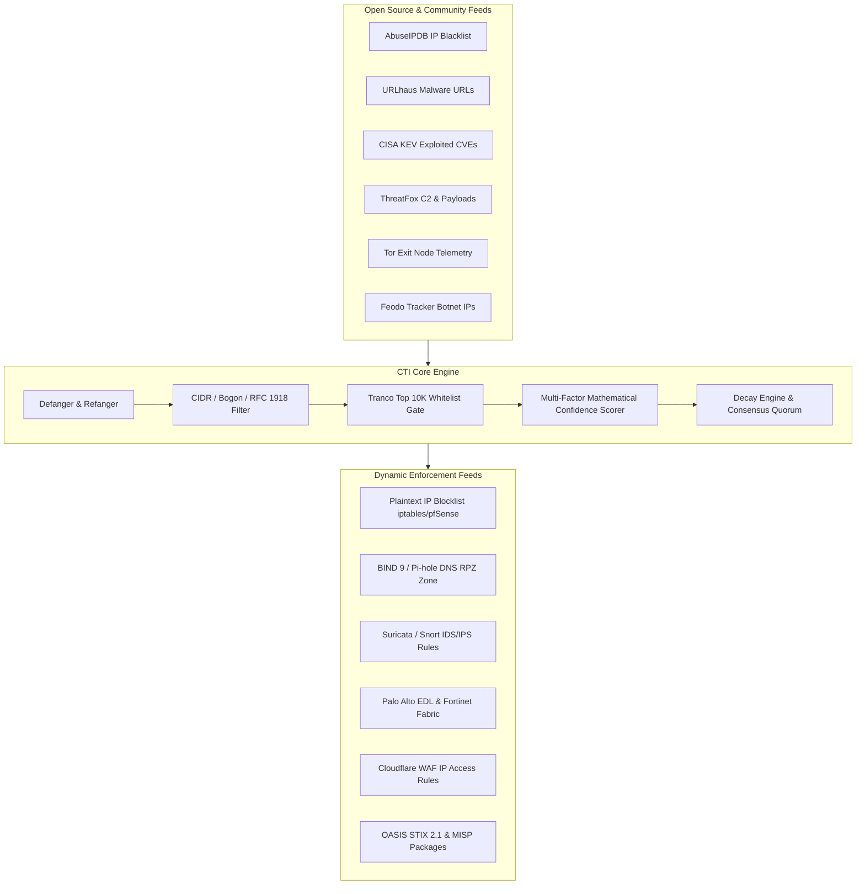

# SENTINEL CTI Operational Runbook & SOC Incident Playbooks

## 1. Overview & Architecture

SENTINEL CTI is an automated Cyber Threat Intelligence aggregation, normalization, and confidence-scoring engine designed for enterprise Security Operations Centers (SOC) and incident response teams.



---

## 2. Multi-Factor Scoring Formula Reference

Indicator confidence scores ($0.0 \dots 100.0$) are computed through a transparent mathematical model:

$$\text{Final Score} = \min\left(100.0, \; \text{Base} \times \text{Weight}_{\text{source}} \times \text{Factor}_{\text{cross}} \times 0.5^{\frac{\Delta t}{T_{1/2}}} + \text{Bonus}_{\text{enrichment}}\right)$$

### Hard Exclusion Overrides (Score = 0.0)
The engine automatically forces the score to $0.0$ and sets `is_whitelisted = true` whenever an indicator matches:
1. **RFC 1918 / Bogon IP Ranges**: `10.0.0.0/8`, `172.16.0.0/12`, `192.168.0.0/16`, `127.0.0.0/8`, `169.254.0.0/16`.
2. **Public Anycast DNS Resolvers**: `1.1.1.1`, `1.0.0.1`, `8.8.8.8`, `8.8.4.4`, `9.9.9.9`.
3. **Tranco Top 10,000 High-Authority Domains**: `google.com`, `microsoft.com`, `apple.com`, `cloudflare.com`, etc.

---

## 3. Perimeter Enforcement Integration Guides

### 3.1 Palo Alto Networks (PAN-OS External Dynamic List)
1. In PAN-OS GUI, navigate to **Objects > External Dynamic Lists**.
2. Click **Add** and configure:
   - **Name**: `Sentinel_CTI_High_Risk_IPs`
   - **Type**: `IP List`
   - **Source URL**: `https://<sentinel-domain>/api/v1/export/firewall.txt?min_score=75`
   - **Recurring**: Hourly
3. Reference `Sentinel_CTI_High_Risk_IPs` in a Security Policy Rule set to **Action: Drop / Reset-Server**.

### 3.2 Fortinet FortiGate (Threat Feed Connector)
1. Go to **Security Fabric > External Connectors**.
2. Create New **IP Address Threat Feed**:
   - **URL**: `https://<sentinel-domain>/api/v1/export/fortinet.txt?min_score=75`
   - **Refresh Rate**: 60 minutes
3. Reference this threat feed object in firewall policy source/destination block rules.

### 3.3 Check Point Security Gateway (Custom Intelligence Feed)
1. In SmartConsole, navigate to **Security Policies > Threat Prevention > Custom Intelligence Feeds**.
2. Click **New** and configure:
   - **Feed URL**: `https://<sentinel-domain>/api/v1/export/checkpoint.txt?min_score=70`
   - **Action**: Drop
   - **Update Interval**: 1 hour

### 3.4 BIND 9 & Pi-hole DNS Sinkholing (Response Policy Zone)
1. In `/etc/named.conf`:
   ```text
   response-policy { zone "rpz.threat-intel.local"; };
   zone "rpz.threat-intel.local" {
       type master;
       file "/var/named/rpz.zone";
       allow-query { any; };
   };
   ```
2. Schedule a cron sync script to pull `GET /api/v1/export/dns-rpz.zone?min_score=70` and run `rndc reload`.

---

## 4. SOC Incident Response Playbooks

### Playbook IR-01: False-Positive Blocklist Remediation
When a legitimate business partner IP or service domain is reported as blocked:
1. **Identify indicator**: Run `cti-cli score <indicator>` to check current score and contributing sources.
2. **Review whitelist filter**: Check `is_whitelisted` and `whitelist_reason`.
3. **Override score**: Submit an emergency override via API or add the domain to `cti_core/processors/whitelist_filter.py`.
4. **Trigger cache flush**: Trigger `/api/v1/pipeline/run` to recompute feeds and force downstream firewall EDL refreshes.

### Playbook IR-02: Zero-Day Campaign Ingestion
When critical CTI is published for an active zero-day APT campaign:
1. **Prepare indicator bundle**: Gather observed C2 IPs, hashes, and dropper URLs into a JSON payload.
2. **Submit bulk batch**: Call `POST /api/v1/indicators/bulk` with `severity: critical` and `tags: ["apt-zeroday", "<campaign_name>"]`.
3. **Verify score distribution**: Call `GET /api/v1/stats` to verify indicators entered `CRITICAL` tier ($\ge 85$).
4. **Deploy immediately**: Firewalls, IDS sensors, and DNS sinkholes will automatically pick up the new indicators on their next polling interval.
